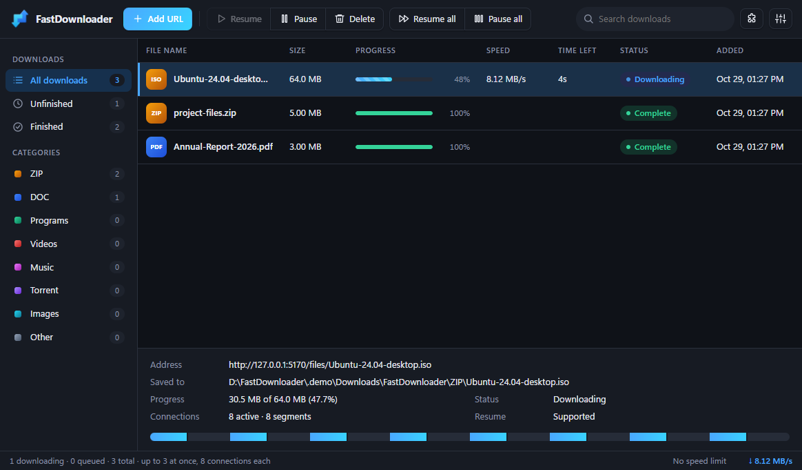

<p align="center"></p>

<h1 align="center">FastDownloader</h1>

<p align="center">A fast, modern download manager for <b>Windows, macOS and Linux</b>.<br>
Multi-connection downloads · pause &amp; resume · videos from websites · torrents · browser extension · privacy built in</p>

<p align="center"><a href="https://github.com/Janardanpal007/FastDownloader-Download/releases/latest"><b>⬇ Download the latest version</b></a></p>



## Download

| System | File | |
|---|---|---|
| **Windows 10 / 11** | `FastDownloader-Setup-1.0.0.exe` | [Download](https://github.com/Janardanpal007/FastDownloader-Download/releases/latest/download/FastDownloader-Setup-1.0.0.exe) |
| **Mac with Apple Silicon** (M1–M4) | `FastDownloader-1.0.0-arm64.dmg` | [Download](https://github.com/Janardanpal007/FastDownloader-Download/releases/latest/download/FastDownloader-1.0.0-arm64.dmg) |
| **Mac with Intel** | `FastDownloader-1.0.0-x64.dmg` | [Download](https://github.com/Janardanpal007/FastDownloader-Download/releases/latest/download/FastDownloader-1.0.0-x64.dmg) |
| **Linux** (any distribution) | `FastDownloader-1.0.0.AppImage` | [Download](https://github.com/Janardanpal007/FastDownloader-Download/releases/latest/download/FastDownloader-1.0.0.AppImage) |
| **Linux** (Ubuntu / Debian) | `FastDownloader-1.0.0.deb` | [Download](https://github.com/Janardanpal007/FastDownloader-Download/releases/latest/download/FastDownloader-1.0.0.deb) |
| **Browser extension** (Chrome, Edge, Brave, Opera, Vivaldi) | `FastDownloader-Extension-Chrome-Edge-Opera-1.6.0.zip` | [Download](https://github.com/Janardanpal007/FastDownloader-Download/releases/latest/download/FastDownloader-Extension-Chrome-Edge-Opera-1.6.0.zip) |
| **Browser extension** (Firefox) | `FastDownloader-Extension-Firefox-1.6.0.zip` | [Download](https://github.com/Janardanpal007/FastDownloader-Download/releases/latest/download/FastDownloader-Extension-Firefox-1.6.0.zip) |

Not sure which Mac you have? Apple menu  → **About This Mac**: "Chip: Apple M…" means Apple Silicon; "Processor: Intel…" means Intel.

## What it does

- **Faster downloads**: each file is split into up to 32 parts (default 8) downloaded at the same time.
- **Pause and resume**, even after closing the app or restarting the computer.
- **Sorted automatically** into `Downloads/FastDownloader/` → **ZIP, DOC, Programs, Videos, Music, Torrent, Images, Other**.
- **Videos from websites**: streams (HLS/DASH) and YouTube, Vimeo, X, Instagram, TikTok, Facebook, Reddit, Twitch and more. Choose quality up to 4K, or audio only (MP3/M4A). Save as **MP4 or MKV**.
- **Torrents and magnet links**, with more peer connections and extra public trackers.
- **Browser extension**: right-click a link → *Download with FastDownloader*; a **Download button on videos** with a quality menu; built-in **ad & tracker blocker**.
- **Queue and speed limiter**, clipboard link catcher, drag & drop, tray / menu-bar icon, light and dark theme.
- **Privacy**: no account, no analytics, no ads. Optional **proxy / Tor** to hide your IP, a **VPN kill switch** for torrents, tracking tags removed from links, history you can clear.

## Installing

### Windows
1. Run `FastDownloader-Setup-1.0.0.exe`.
2. If Windows shows **"Windows protected your PC"**, click **More info → Run anyway**. This appears because the app isn't code-signed yet; it isn't a virus warning.
3. Follow the installer. FastDownloader starts and sits in the system tray (next to the clock).

### macOS
1. Open the `.dmg` that matches your Mac and **drag FastDownloader into Applications**.
2. Open it from Applications. macOS blocks it the first time because it isn't signed by Apple:
   go to **System Settings → Privacy & Security**, scroll down and click **Open Anyway**, then confirm.
   (On older macOS you can also right-click the app → **Open**.)
3. If macOS says the app **"is damaged and can't be opened"**, open Terminal and run:
   ```bash
   xattr -dr com.apple.quarantine /Applications/FastDownloader.app
   ```
   Then open it again. This message is about the missing Apple signature, not real damage.
4. The FastDownloader icon appears in the **menu bar** at the top right.

### Linux
- **AppImage:** `chmod +x FastDownloader-1.0.0.AppImage`, then double-click it or run `./FastDownloader-1.0.0.AppImage`.
- **Ubuntu / Debian:** `sudo apt install ./FastDownloader-1.0.0.deb`

### Browser extension
**Chrome, Edge, Brave, Opera, Vivaldi**
1. Unzip `FastDownloader-Extension-Chrome-Edge-Opera-1.6.0.zip` into a folder you'll keep (for example *Documents/FastDownloader-extension*).
2. Open the browser's extensions page (`chrome://extensions`, `edge://extensions`, `brave://extensions`, `opera://extensions`…) and switch on **Developer mode**.
3. Click **Load unpacked** and choose the unzipped folder.
4. Click the **puzzle-piece icon** next to the address bar and **pin** FastDownloader. With the app running, its popup says **Connected**.

Shortcut: in the app, click the **puzzle icon → Add to …**. It finds your browsers, copies the extension and opens the right page for you.

**Firefox**
Firefox only keeps add-ons signed by Mozilla. Until a signed version is published here, use **Add to Firefox** in the app.
It loads the add-on until Firefox restarts (*about:debugging → This Firefox → Load Temporary Add-on…* and pick `manifest.json`).
Then click the extension's icon and **Allow on all websites**.

**Safari** has no extension. Copy a link (FastDownloader offers to download it) or drag it onto the window.

## Privacy

FastDownloader doesn't collect anything. There's no account, no analytics and no ads, and it only connects to the sites
you download from, plus GitHub to fetch and update the video-site helper *yt-dlp*. In **Settings → Privacy**
you can send downloads through **Tor** or a **SOCKS5/HTTP proxy** (if the proxy stops, downloads stop rather than
using your real connection), ask sites not to track you, strip tracking tags from links, and clear or turn off history.
For **torrents**, use a VPN and switch on the **VPN kill switch** in **Settings → Torrents**: torrents only run while the VPN is connected.

## Please use it responsibly

Download only what you have the right to. Many video sites' terms of service (YouTube's included) don't allow
downloading except through their own apps, and sharing copyrighted films, music or software without permission is
illegal in most countries. DRM-protected services (Netflix, Prime Video, Disney+, Spotify…) are not supported.

## Verify your download (optional)

Each release includes `SHA256SUMS.txt`. Compare it with the checksum of your file:

- **Windows (PowerShell):** `Get-FileHash .\FastDownloader-Setup-1.0.0.exe -Algorithm SHA256`
- **macOS / Linux:** `shasum -a 256 FastDownloader-1.0.0-arm64.dmg`

## Problems or ideas?

Open an [issue](https://github.com/Janardanpal007/FastDownloader-Download/issues) and describe what happened,
including your system (Windows / macOS / Linux version) and, if possible, a screenshot.

## Licence

FastDownloader © 2026 Janardan/TSE. Released under the MIT licence ([LICENSE](LICENSE)).
It includes open-source components, listed in [THIRD_PARTY_NOTICES.md](THIRD_PARTY_NOTICES.md).
